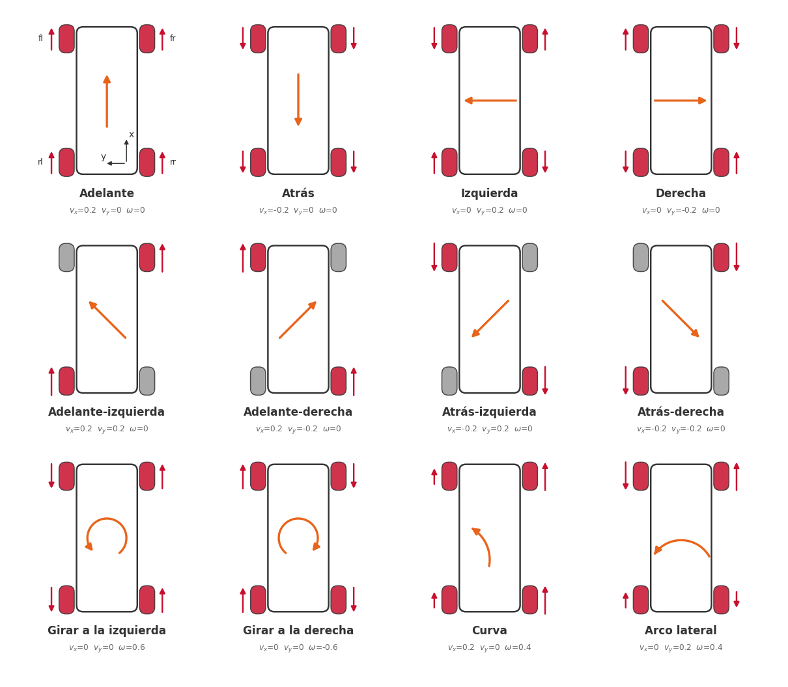
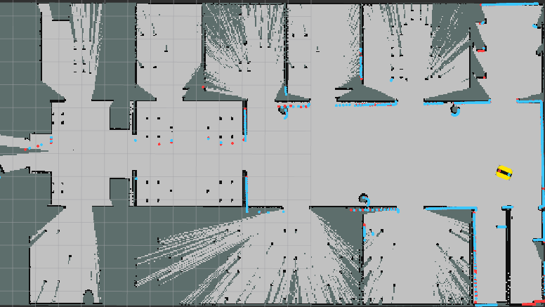
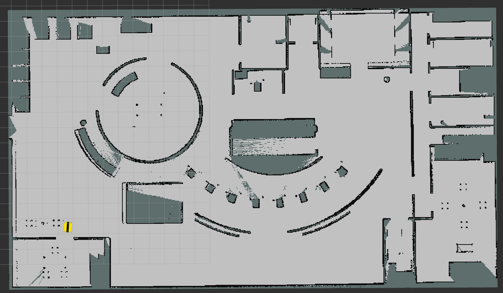

# Workshop 03 — Robot omnidireccional

**Probado en:** Ubuntu 24.04 · ROS 2 Jazzy · Gazebo Harmonic (gz-sim 8)

Taller con el Clearpath Dingo-O (4 ruedas mecanum) en Gazebo, en dos partes:

1. **Figura con el modelo omnidireccional:** armas una figura y la recorres con tu propio controlador, calculando la velocidad de cada rueda.
2. **Mapeo:** con el controlador de Clearpath mueves el robot desde la GUI de Gazebo, construyes el mapa de un mundo y lo guardas.

| Parte | Controlador del robot | Launch |
|---|---|---|
| 1 | **propio**: el de Clearpath se quita y las ruedas reciben tus velocidades | `ros2 launch taller_omni taller.launch.py` |
| 2 | **Clearpath**: recibe $(v_x, v_y, \omega)$ por `cmd_vel` y calcula él las ruedas | `ros2 launch taller_omni simulacion.launch.py` |

## Antes de empezar

Instala y compila todo siguiendo [`REQUERIMIENTOS.md`](REQUERIMIENTOS.md): Ubuntu 24.04 y ROS 2 Jazzy, los repositorios de Clearpath (no vienen en este repositorio), Nav2 y slam_toolbox, y la compilación del workspace.

| Carpeta de `src/` | Qué es |
|---|---|
| `taller_omni/` | el taller: `self_controller.py`, `trajectory.py` y `graficar.py`, los launch (`simulacion`, `taller`, `mapeo`), la configuración del robot y de los mundos (`config/`) y RViz |
| `worlds/` | mundos de Gazebo: `worlds/` (los `.sdf`) y `models/` (sus piezas) |
| `omni_teleop_gui/` | panel de teleoperación de la GUI de Gazebo |
| `dependencias.repos` | versiones de los repositorios de Clearpath que se descargan |

En cada terminal, primero:

```bash
cd ~/workshop_03 && source install/setup.bash
```

## 1. Figura con el modelo omnidireccional

### Modelo matemático

En el **marco del robot**, $x$ apunta hacia adelante, $y$ hacia la izquierda y $\omega$ es positivo en sentido antihorario.

| Parámetro | Símbolo | Valor |
|---|---|---|
| Radio de rueda | $r$ | 0.05 m |
| Distancia del centro al eje de ruedas (adelante/atrás) | $l_x$ | 0.285 m |
| Distancia del centro al centro de rueda (lateral) | $l_y$ | 0.1854 m |

**Del mundo al robot.** La trayectoria se da en el marco del mundo $(\dot x, \dot y, \dot\theta)$, pero el robot se mueve en su propio marco. Si está girado un ángulo $\theta$:

$$\begin{bmatrix}v_x\\ v_y\end{bmatrix} = \begin{bmatrix}\cos\theta & \sin\theta\\ -\sin\theta & \cos\theta\end{bmatrix}\begin{bmatrix}\dot x\\ \dot y\end{bmatrix}, \qquad \omega = \dot\theta$$

**Cinemática inversa de las ruedas mecanum.** Cada rueda tiene rodillos a 45°, por eso combinando las cuatro se logra cualquier movimiento en el plano:

$$\begin{bmatrix}\omega_{fl}\\ \omega_{fr}\\ \omega_{rl}\\ \omega_{rr}\end{bmatrix} = \frac{1}{r}\begin{bmatrix}1 & -1 & -(l_x+l_y)\\ 1 & 1 & (l_x+l_y)\\ 1 & 1 & -(l_x+l_y)\\ 1 & -1 & (l_x+l_y)\end{bmatrix}\begin{bmatrix}v_x\\ v_y\\ \omega\end{bmatrix}$$

- **$v_x$** (avanzar): las 4 ruedas giran igual.
- **$v_y$** (lateral izquierda): las ruedas de cada diagonal giran igual y las dos diagonales en sentido contrario.
- **$\omega$** (girar): las ruedas izquierdas hacia atrás y las derechas hacia adelante, con brazo de palanca $l_x + l_y$.

<p align="center">
  
</p>

Vista desde arriba con el frente del robot hacia arriba ($x$ adelante, $y$ a la izquierda). Las flechas rojas son el sentido de giro de cada rueda, y son más largas cuanto más rápido gira la rueda. Las ruedas grises están detenidas, y la flecha naranja es el movimiento del robot. Cada caso sale de la matriz de arriba con las velocidades indicadas.

Ejemplo: avanzar a 0.2 m/s da $\omega = 0.2 / 0.05 = 4$ rad/s en las cuatro ruedas.

### Archivos

| Archivo | Qué haces |
|---|---|
| `taller_omni/taller_omni/self_controller.py` | completas `mundo_a_robot()` y `cinematica_inversa()` con las ecuaciones de arriba |
| `taller_omni/taller_omni/trajectory.py` | armas tu figura con rectas, diagonales, arcos y giros, y la agregas a `FIGURAS` |

### Tu propia figura

1. Abre `taller_omni/taller_omni/trajectory.py` y busca el diccionario `FIGURAS`, al final del archivo.
2. Agrega una entrada: el **nombre** entre comillas y, después de `lambda:`, la cadena de movimientos. Los movimientos se miden desde donde arranca el robot ($x$ hacia su frente, $y$ hacia su izquierda; metros y grados):

   ```python
   FIGURAS = {
       'cuadrado': ...,                                  # las que ya estaban
       'mi_figura': lambda: (Trayectoria()
                             .recta(1.0, 0.0)              # 1 m hacia adelante
                             .diagonal(0.8, 135)           # 0.8 m hacia atrás a la izquierda
                             .arco(0.5, 180)               # media vuelta a la izquierda, radio 0.5 m
                             .giro(90)                     # gira 90° sobre sí mismo
                             .recta(0.0, -1.0, girar=90)), # va de lado mientras gira
   }
   ```

3. Guarda el archivo y llama a tu figura por su nombre con `-p figura:=mi_figura` (ver abajo). No hace falta recompilar.

| Movimiento | Qué hace |
|---|---|
| `recta(dx, dy)` | avanza en línea recta `dx` metros en $x$ y `dy` en $y$ |
| `diagonal(distancia, angulo)` | recta en la dirección `angulo` (0 = adelante, 90 = izquierda, 45 = adelante-izquierda) |
| `arco(radio, angulo)` | curva de `angulo` grados (positivo a la izquierda, negativo a la derecha) |
| `giro(angulo)` | gira sobre sí mismo sin moverse |
| `pausa(segundos)` | se queda quieto |

`recta`, `diagonal` y `arco` aceptan `v=` (velocidad en m/s, 0.2 por defecto) y `girar=` (grados que rota el robot mientras avanza).

Ya vienen de ejemplo `cuadrado`, `cuadrado_2m`, `cuadrado_girando`, `rombo`, `circulo`, `ocho` y `demo`. La arena mide 6 × 6 m y el robot arranca en (0, −1,5) mirando hacia +x: tiene 4,5 m libres hacia su izquierda y 3 m hacia adelante y hacia atrás. Deja 0,5 m entre el centro del robot y las paredes.

### En el simulador

```bash
# Terminal 1: arena con el controlador propio (espera "Controlador por rueda activo")
ros2 launch taller_omni taller.launch.py rviz:=true

# Terminal 2: tu controlador recorre la figura indicada por su nombre en FIGURAS
ros2 run taller_omni self_controller --ros-args -p figura:=cuadrado
ros2 run taller_omni self_controller --ros-args -p figura:=mi_figura
```

Sin `-p figura:=...` recorre el `cuadrado`. Si el nombre no existe, el nodo muestra la lista de figuras disponibles. Cada vez que lo ejecutas, el robot recorre la figura una vez desde donde esté; para volver al inicio, relanza la terminal 1.

`self_controller` evalúa la figura 20 veces por segundo, pasa la velocidad al marco del robot con `mundo_a_robot()`, calcula las ruedas con `cinematica_inversa()` y las publica en `/do100_0000/wheel_velocity_controller/commands`, en el orden `[fl, fr, rl, rr]` (rad/s). Después de editar los archivos no hace falta recompilar: vuelve a ejecutar el nodo.

El launch también corre `graficar`, que mide cada recorrido. En RViz se ven tres caminos: el **deseado** (blanco), el **real** según Gazebo (azul) y el de la **odometría** calculada con la velocidad de las ruedas (naranja). Al terminar guarda en `~/taller_resultados/` un gráfico con los tres caminos y el error de posición respecto al deseado.

| Tópico | Contenido |
|---|---|
| `/taller/pose_real` | pose exacta del robot en Gazebo |
| `/taller/odometria` | odometría: velocidad de las ruedas integrada con la cinemática directa |
| `/taller/camino/deseado`, `/real`, `/odometria` | caminos del recorrido (`nav_msgs/Path`), en el marco `world` |

La odometría solo sabe lo que giraron las ruedas: si una rueda patina, no se entera. Por eso el camino real puede alejarse del deseado aunque la odometría diga que va bien.

## 2. Mapeo con el controlador de Clearpath

Con Nav2 y slam_toolbox instalados (sección 4 de [`REQUERIMIENTOS.md`](REQUERIMIENTOS.md)), elige uno de los [mundos disponibles](#mundos-disponibles):

```bash
# Terminal 1: simulación con el controlador de Clearpath en el mundo a mapear
ros2 launch taller_omni simulacion.launch.py mundo:=oficina_2

# Terminal 2: SLAM y RViz con el mapa (el mapa se publica en /do100_0000/map)
ros2 launch taller_omni mapeo.launch.py

# Terminal 3: guardar el mapa cuando esté completo (crea ~/mapa_oficina_2.pgm y .yaml)
ros2 run nav2_map_server map_saver_cli -f ~/mapa_oficina_2 \
  --ros-args -r map:=/do100_0000/map -p use_sim_time:=true
```

`mapeo.launch.py` lanza el SLAM de Clearpath (`clearpath_nav2_demos`) y un RViz con el marco fijo `map`, el mapa, el robot y los lidars (`taller_omni/rviz/mapeo.rviz`). Las transformadas del robot, y la `map → odom` que publica el SLAM, van en `/do100_0000/tf` y `/do100_0000/tf_static`, no en `/tf`: por eso el launch abre RViz con esos remapeos. Un `rviz2` abierto a mano sin ellos no encuentra el frame del robot ni `map`.

Para recorrer el mundo, en el panel **Teleop omnidireccional** de la GUI de Gazebo (a la derecha): mantener presionada una flecha mueve el robot y al soltar se detiene. Con el panel enfocado también responde a `W`/`S` (avanzar), `A`/`D` (lateral) y `Q`/`E` (girar). El panel publica en `/do100_0000/cmd_vel`, y el controlador de Clearpath convierte ese comando en la velocidad de cada rueda, como hiciste tú en la parte 1.

#### Note: Ejemplos de Mapping usando Lidar 2D 
<p align="center"> 
  
  
</p>

<p align="center"> 
  
</p>


## Mundos disponibles

| `mundo:=` | Escenario |
|---|---|
| `arena` | Arena de 6 × 6 m con paredes de 0,8 m y líneas en el piso cada 1 m, para probar trayectorias; el robot aparece en (0, −1,5), centrado y más cerca de la pared de abajo, mirando hacia +x |
| `coral` | Laboratorio CoRAL  |
| `casa` | Vivienda de una planta, 17 × 9 m |
| `oficina_0` | Oficina pequeña con 5 despachos,  11 × 9,75 m |
| `oficina_1` | Planta abierta con salas perimetrales, 19,3 × 10,65 m |
| `oficina_2` | Planta alargada con despachos y patio, 13,5 × 22,8 m |
| `oficina_3` (por defecto) | Salón de belleza con muros curvos, 14,4 × 18 m |
| `oficina_4` | Clínica de ortodoncia con muros curvos, 32 × 18,15 m |

Cualquier mundo se abre con `ros2 launch taller_omni simulacion.launch.py mundo:=<nombre>` (controlador de Clearpath). La posición inicial del robot en cada mundo está en `taller_omni/config/mundos.yaml`; se puede cambiar al lanzar con `x:=`, `y:=` y `yaw:=`. El Dingo-O mide unos 0,68 × 0,57 m: en los escenarios de interiores pasa los vanos (1,20 m) y recorre las zonas abiertas, pero no entra en los cuartos pequeños.

## Problemas frecuentes

| Síntoma | Causa probable |
|---|---|
| `Package 'taller_omni' not found` | falta `source install/setup.bash` en esa terminal |
| `self_controller` se queda en *"Esperando al simulador"* | el simulador no está corriendo, o todavía no aparece *"Controlador por rueda activo"* |
| `Falta tu parte: completa ...` | esa función de `self_controller.py` todavía tiene el `raise NotImplementedError` |
| El robot no responde, aparece *"No clock received"* o el controlador no arranca | quedó corriendo una simulación anterior: ciérrala, ejecuta `pkill -f "gz sim"` y vuelve a lanzar |
| El panel de Gazebo no mueve el robot | se lanzó `taller.launch.py` (controlador propio); para la parte 2 usa `taller_omni simulacion.launch.py` |
| RViz: el frame del robot o `map` no existe | RViz se abrió sin remapear `/tf`; ábrelo con `ros2 launch taller_omni mapeo.launch.py` |
| RViz: error `GLSL link result ... indexed_8bit_image` | aviso del driver gráfico al dibujar el mapa; si el mapa se ve, se puede ignorar |
| El robot choca con una pared | no hay espacio desde donde quedó: relanza el simulador para volver al inicio |
