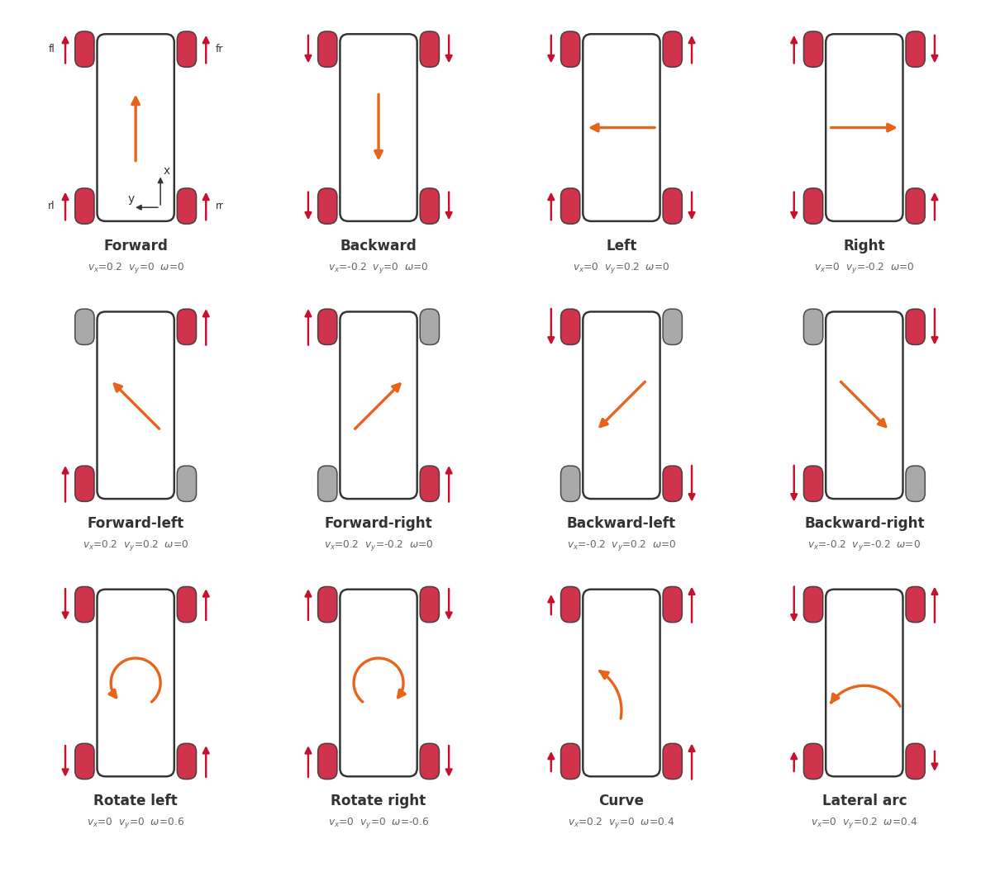
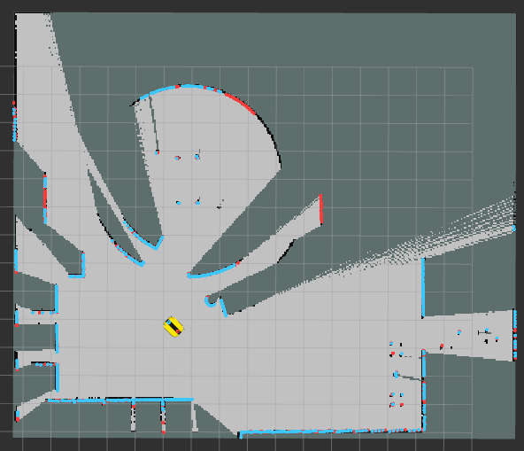

# Workshop 03 — Omnidirectional robot

**Tested on:** Ubuntu 24.04 · ROS 2 Jazzy · Gazebo Harmonic (gz-sim 8)

Workshop with the Clearpath Dingo-O (4 mecanum wheels) in Gazebo, in two parts:

1. **Figure with the omnidirectional model:** you build a figure and follow it with your own controller, computing the velocity of each wheel.
2. **Mapping:** with Clearpath's controller you drive the robot from the Gazebo GUI, build the map of a world and save it.

| Part | Robot controller | Launch |
|---|---|---|
| 1 | **own**: Clearpath's controller is removed and the wheels receive your velocities | `ros2 launch omni_workshop workshop.launch.py` |
| 2 | **Clearpath**: receives $(v_x, v_y, \omega)$ on `cmd_vel` and computes the wheels itself | `ros2 launch omni_workshop simulation.launch.py` |

## Before you start

Install and build everything following [`REQUIREMENTS.md`](REQUIREMENTS.md): Ubuntu 24.04 and ROS 2 Jazzy, the Clearpath repositories (not included in this repository), Nav2 and slam_toolbox, and the workspace build.

| Folder in `src/` | What it is |
|---|---|
| `omni_workshop/` | the workshop: `self_controller.py`, `trajectory.py` and `plotter.py`, the launch files (`simulation`, `workshop`, `mapping`), the robot and world configuration (`config/`) and RViz |
| `worlds/` | Gazebo worlds: `worlds/` (the `.sdf` files) and `models/` (their pieces) |
| `omni_teleop_gui/` | teleoperation panel for the Gazebo GUI |
| `dependencies.repos` | versions of the Clearpath repositories to download |

In every terminal, first:

```bash
cd ~/workshop_03 && source install/setup.bash
```

## 1. Figure with the omnidirectional model

### Mathematical model

In the **robot frame**, $x$ points forward, $y$ to the left and $\omega$ is positive counterclockwise.

| Parameter | Symbol | Value |
|---|---|---|
| Wheel radius | $r$ | 0.05 m |
| Distance from the center to the wheel axle (front/back) | $l_x$ | 0.285 m |
| Distance from the center to the wheel center (sideways) | $l_y$ | 0.1854 m |

**From the world to the robot.** The trajectory is given in the world frame $(\dot x, \dot y, \dot\theta)$, but the robot moves in its own frame. If it is rotated by an angle $\theta$:

```math
\begin{bmatrix}v_x\\ v_y\end{bmatrix} = \begin{bmatrix}\cos\theta & \sin\theta\\ -\sin\theta & \cos\theta\end{bmatrix}\begin{bmatrix}\dot x\\ \dot y\end{bmatrix}, \qquad \omega = \dot\theta
```

**Inverse kinematics of the mecanum wheels.** Each wheel has rollers at 45°, so combining the four any motion in the plane is possible:

```math
\begin{bmatrix}\omega_{fl}\\ \omega_{fr}\\ \omega_{rl}\\ \omega_{rr}\end{bmatrix} = \frac{1}{r}\begin{bmatrix}1 & -1 & -(l_x+l_y)\\ 1 & 1 & (l_x+l_y)\\ 1 & 1 & -(l_x+l_y)\\ 1 & -1 & (l_x+l_y)\end{bmatrix}\begin{bmatrix}v_x\\ v_y\\ \omega\end{bmatrix}
```

- **$`v_x`$** (forward): the 4 wheels spin the same.
- **$`v_y`$** (sideways to the left): the wheels on each diagonal spin the same and the two diagonals spin in opposite directions.
- **$`\omega`$** (rotate): the left wheels spin backwards and the right ones forwards, with lever arm $l_x + l_y$.

<p align="center">
  
</p>

Top view with the front of the robot facing up ($x$ forward, $y$ to the left). The red arrows are the spin direction of each wheel, and they are longer the faster the wheel spins. Gray wheels are stopped, and the orange arrow is the motion of the robot. Each case comes from the matrix above with the velocities shown.

Example: moving forward at 0.2 m/s gives $\omega = 0.2 / 0.05 = 4$ rad/s on all four wheels.

### Files

| File | What you do |
|---|---|
| `omni_workshop/omni_workshop/self_controller.py` | complete `world_to_robot()` and `inverse_kinematics()` with the equations above |
| `omni_workshop/omni_workshop/trajectory.py` | build your figure with lines, diagonals, arcs and turns, and add it to `FIGURES` |

### Your own figure

1. Open `omni_workshop/omni_workshop/trajectory.py` and find the `FIGURES` dictionary at the end of the file.
2. Add an entry: the **name** in quotes and, after `lambda:`, the chain of moves. Moves are measured from where the robot starts ($x$ towards its front, $y$ towards its left; meters and degrees):

   ```python
   FIGURES = {
       'square': ...,                                    # the existing ones
       'my_figure': lambda: (Trajectory()
                             .line(1.0, 0.0)               # 1 m forward
                             .diagonal(0.8, 135)           # 0.8 m backwards to the left
                             .arc(0.5, 180)                # half turn to the left, 0.5 m radius
                             .turn(90)                     # rotate 90° in place
                             .line(0.0, -1.0, rotate=90)), # move sideways while rotating
   }
   ```

3. Save the file and call your figure by its name with `-p figure:=my_figure` (see below). No rebuild needed.

| Move | What it does |
|---|---|
| `line(dx, dy)` | moves in a straight line `dx` meters in $x$ and `dy` in $y$ |
| `diagonal(distance, angle)` | straight line in the direction `angle` (0 = forward, 90 = left, 45 = forward-left) |
| `arc(radius, angle)` | curve of `angle` degrees (positive to the left, negative to the right) |
| `turn(angle)` | rotates in place without moving |
| `pause(seconds)` | stays still |

`line`, `diagonal` and `arc` accept `v=` (speed in m/s, 0.2 by default) and `rotate=` (degrees the robot turns while moving).

The examples `square`, `square_2m`, `square_rotating`, `rhombus`, `circle`, `figure_eight` and `demo` are included. The arena is 6 × 6 m and the robot starts at (0, −1.5) facing +x: it has 4.5 m free to its left and 3 m forwards and backwards. Keep 0.5 m between the center of the robot and the walls.

### In the simulator

```bash
# Terminal 1: arena with the own controller (wait for "Wheel controller active")
ros2 launch omni_workshop workshop.launch.py rviz:=true

# Terminal 2: your controller follows the figure given by its name in FIGURES
ros2 run omni_workshop self_controller --ros-args -p figure:=square
ros2 run omni_workshop self_controller --ros-args -p figure:=my_figure
```

Without `-p figure:=...` it follows the `square`. If the name does not exist, the node lists the available figures. Each time you run it, the robot follows the figure once from wherever it is; to go back to the start, relaunch terminal 1.

`self_controller` evaluates the figure 20 times per second, converts the velocity to the robot frame with `world_to_robot()`, computes the wheels with `inverse_kinematics()` and publishes them on `/do100_0000/wheel_velocity_controller/commands`, in the order `[fl, fr, rl, rr]` (rad/s). After editing the files there is no need to rebuild: just run the node again.

The launch also runs `plotter`, which measures each run. RViz shows three paths: the **desired** one (white), the **actual** one according to Gazebo (blue) and the **odometry** one computed from the wheel velocities (orange). At the end it saves to `~/workshop_results/` a plot with the three paths and the position error with respect to the desired one.

| Topic | Content |
|---|---|
| `/workshop/ground_truth` | exact robot pose in Gazebo |
| `/workshop/odometry` | odometry: wheel velocities integrated with the forward kinematics |
| `/workshop/path/desired`, `/actual`, `/odometry` | paths of the run (`nav_msgs/Path`), in the `world` frame |

The odometry only knows how much the wheels turned: if a wheel slips, it does not notice. That is why the actual path can drift from the desired one even when the odometry says everything is fine.

## 2. Mapping with Clearpath's controller

With Nav2 and slam_toolbox installed (section 4 of [`REQUIREMENTS.md`](REQUIREMENTS.md)), pick one of the [available worlds](#available-worlds):

```bash
# Terminal 1: simulation with Clearpath's controller in the world to map
ros2 launch omni_workshop simulation.launch.py world:=office_2

# Terminal 2: SLAM and RViz with the map (the map is published on /do100_0000/map)
ros2 launch omni_workshop mapping.launch.py

# Terminal 3: save the map when it is complete (creates ~/map_office_2.pgm and .yaml)
ros2 run nav2_map_server map_saver_cli -f ~/map_office_2 \
  --ros-args -r map:=/do100_0000/map -p use_sim_time:=true
```

`mapping.launch.py` launches Clearpath's SLAM (`clearpath_nav2_demos`) and an RViz with the `map` fixed frame, the map, the robot and the lidars (`omni_workshop/rviz/mapping.rviz`). The robot transforms, and the `map → odom` one published by SLAM, are on `/do100_0000/tf` and `/do100_0000/tf_static`, not on `/tf`: that is why the launch opens RViz with those remappings. An `rviz2` opened by hand without them cannot find the robot frame or `map`.

To drive around the world, use the **Omnidirectional teleop** panel of the Gazebo GUI (on the right): holding an arrow moves the robot and releasing it stops. With the panel focused it also responds to `W`/`S` (forward), `A`/`D` (sideways) and `Q`/`E` (rotate). The panel publishes on `/do100_0000/cmd_vel`, and Clearpath's controller turns that command into the velocity of each wheel, as you did in part 1.

#### Note: mapping examples with a 2D lidar
<p align="center">
  
  
</p>

<p align="center">
  
</p>


## Available worlds

| `world:=` | Scenario |
|---|---|
| `arena` | 6 × 6 m arena with 0.8 m walls and floor lines every 1 m, for testing trajectories; the robot spawns at (0, −1.5), centered and closer to the bottom wall, facing +x |
| `coral` | CoRAL laboratory |
| `house` | Single-story house, 17 × 9 m |
| `office_0` | Small office with 5 private offices, 11 × 9.75 m |
| `office_1` | Open floor plan with perimeter rooms, 19.3 × 10.65 m |
| `office_2` | Long floor plan with private offices and a courtyard, 13.5 × 22.8 m |
| `office_3` (default) | Beauty salon with curved walls, 14.4 × 18 m |
| `office_4` | Orthodontic clinic with curved walls, 32 × 18.15 m |

Any world opens with `ros2 launch omni_workshop simulation.launch.py world:=<name>` (Clearpath's controller). The start pose of the robot in each world is in `omni_workshop/config/worlds.yaml`; it can be changed at launch with `x:=`, `y:=` and `yaw:=`. The Dingo-O is about 0.68 × 0.57 m: in the indoor scenarios it fits through the doorways (1.20 m) and drives through the open areas, but it does not fit in the small rooms.

## Troubleshooting

| Symptom | Likely cause |
|---|---|
| `Package 'omni_workshop' not found` | missing `source install/setup.bash` in that terminal |
| `self_controller` stays at *"Waiting for the simulation"* | the simulation is not running, or *"Wheel controller active"* has not appeared yet |
| `Your part is missing: complete ...` | that function in `self_controller.py` still has the `raise NotImplementedError` |
| The robot does not respond, *"No clock received"* appears or the controller does not start | a previous simulation is still running: close it, run `pkill -f "gz sim"` and launch again |
| The Gazebo panel does not move the robot | `workshop.launch.py` was launched (own controller); for part 2 use `omni_workshop simulation.launch.py` |
| RViz: the robot frame or `map` does not exist | RViz was opened without remapping `/tf`; open it with `ros2 launch omni_workshop mapping.launch.py` |
| RViz: error `GLSL link result ... indexed_8bit_image` | graphics driver warning when drawing the map; if the map shows, it can be ignored |
| The robot hits a wall | there is no room from where it stopped: relaunch the simulation to go back to the start |
